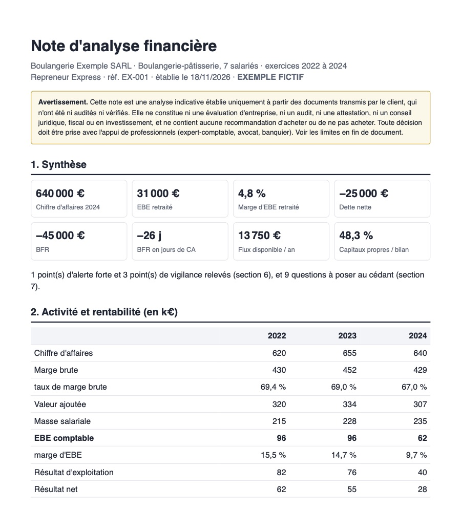

# Repreneur Express

**Site en ligne : [repreneurexpress.fr](https://repreneurexpress.fr)**

Service d'analyse financière express pour les personnes qui veulent reprendre une petite entreprise (commerce, artisanat, PME). À partir de 2 ou 3 bilans, le client reçoit en 48 h une note claire qui l'aide à comprendre la santé de l'entreprise et à préparer ses questions au cédant.

## Le problème

Un repreneur reçoit souvent des liasses fiscales difficiles à lire. Un audit complet coûte cher et arrive tard dans le processus. Entre les deux, il n'existe presque rien pour faire un premier tri rapide et à petit prix.

## Ce que j'ai construit

| Partie | Description |
|---|---|
| **Moteur d'analyse** (Python) | Lit les comptes saisis, calcule les principaux indicateurs (rentabilité, besoin en fonds de roulement, endettement, capacité de remboursement), signale les points de vigilance et produit une note HTML/PDF mise en page |
| **Import automatique** | Récupère les comptes publics via l'API de l'INPI et vérifie leur cohérence |
| **Site vitrine** | Page de vente, exemple de note et pages légales. HTML/CSS sans framework, hébergé sur Netlify |
| **Cadre juridique** | CGV, politique de confidentialité, mentions légales, engagement de confidentialité adaptés à une micro-entreprise |
| **Lancement** | Plan de lancement avec un budget de 50 € maximum, procédure de livraison, suivi des indicateurs |

Ce dépôt contient uniquement le **site vitrine**, dans `site/`. Le moteur d'analyse, la méthode et les documents internes restent privés.

## Voir le site en local

Ouvrir `site/index.html` dans un navigateur. L'exemple de note complet se trouve dans `site/exemple.html`. Il s'agit d'une entreprise **fictive**.

## Compétences mobilisées

Analyse financière (lecture de liasse fiscale, retraitements), Python, intégration d'API, HTML/CSS responsive, rédaction juridique et commerciale, conception d'une offre et d'un plan de lancement.

---

© 2026 Yanis Hubert, tous droits réservés. Ce code est publié pour être consulté. Il ne peut être ni réutilisé ni redistribué sans autorisation.
